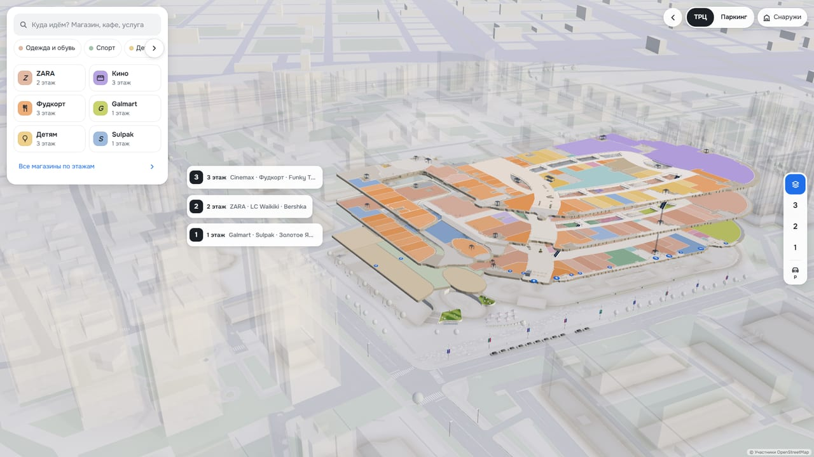
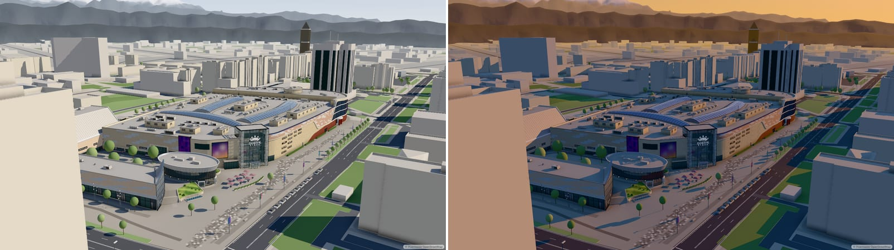

# Dostyk Plaza 3D — демо

Интерактивная 3D-модель ТРЦ Dostyk Plaza (Алматы) для приложения Smart Plaza. Здесь лежит собранный вьюер (без исходников); сайт закрыт от поисковиков.

## Версии

| Версия | Что внутри | Открыть | Один файл |
|---|---|---|---|
| **Показ на ноутбуке — красивая версия 7.2** (14.10.2026) | та же карта 7.2, но с детальной моделью для показа: обставленные магазины и витрины, эскалаторы, машины на паркинге, подробный экстерьер. Для ноутбука или компьютера; на слабом устройстве сама переходит на лёгкую версию. QR со стоек по-прежнему ведут на лёгкую /mall/ | [здание](https://daulet-rama.github.io/dostyk-plaza-3d-demo/showcase/) · [ТРЦ](https://daulet-rama.github.io/dostyk-plaza-3d-demo/showcase/mall.html) · [демо «Найти путь»](https://daulet-rama.github.io/dostyk-plaza-3d-demo/showcase/?demo=route) · [для докладчика](https://daulet-rama.github.io/dostyk-plaza-3d-demo/showcase/mall.html?present=1) · [паркинг](https://daulet-rama.github.io/dostyk-plaza-3d-demo/showcase/parking.html) | — |
| **Сценарии «что если»** (14.10.2026) | демо-макет для руководства: поменять магазины местами (список, план, 3D), убрать магазин, поставить бренд из каталога; ассистент даёт прогноз по демо-правилам с источниками; сравнение и отчёт A4. **Цифры условные, аналитической модели пока нет.** Три варианта интерфейса: «Макет» (всё на одном экране), «Стекло» (светлый, 3D на весь экран), «Графит» (тёмный, по шагам, для проектора) | [Макет](https://daulet-rama.github.io/dostyk-plaza-3d-demo/scenarii/) · [Стекло](https://daulet-rama.github.io/dostyk-plaza-3d-demo/scenarii-steklo/) · [Графит](https://daulet-rama.github.io/dostyk-plaza-3d-demo/scenarii-grafit/) | — |
| **v7.2 — «ТРЦ · 3 этажа», QR, «Иду сам»** (11.10.2026, обновлено 14.10.2026) | этажи 1–3 по планам управляющей компании, поиск по всем этажам, посадка по QR на телефоне, маршрут с эскалатором между этажами, паркинг и «Где моя машина» | [здание](https://daulet-rama.github.io/dostyk-plaza-3d-demo/mall/) · [ТРЦ](https://daulet-rama.github.io/dostyk-plaza-3d-demo/mall/mall.html) · [QR-03 на телефоне](https://daulet-rama.github.io/dostyk-plaza-3d-demo/mall/#qr=QR-03) · [демо «Найти путь»](https://daulet-rama.github.io/dostyk-plaza-3d-demo/mall/?demo=route) · [для докладчика](https://daulet-rama.github.io/dostyk-plaza-3d-demo/mall/mall.html?present=1) · [QR-коды](https://daulet-rama.github.io/dostyk-plaza-3d-demo/mall/qr.html) · [паркинг](https://daulet-rama.github.io/dostyk-plaza-3d-demo/mall/parking.html) | [embed.html](https://daulet-rama.github.io/dostyk-plaza-3d-demo/mall/embed.html) |
| v6 — «Где моя машина» (10.10.2026) | демо для докладчика на модели паркинга: два способа узнать, где стоит машина гостя, и текст «Как это работает» | [режим 1](https://daulet-rama.github.io/dostyk-plaza-3d-demo/car/car-demo.html) · [режим 2](https://daulet-rama.github.io/dostyk-plaza-3d-demo/car/car-demo.html?variant=2) · [Как это работает](https://daulet-rama.github.io/dostyk-plaza-3d-demo/car/how-it-works.html) | [embed.html](https://daulet-rama.github.io/dostyk-plaza-3d-demo/car/embed.html?demo=car) |
| v5 — тени (09.10.2026) | всё из v4 + тени солнца по эталону Blender Cycles, новый вечер | [shadows/](https://daulet-rama.github.io/dostyk-plaza-3d-demo/shadows/) | [embed.html](https://daulet-rama.github.io/dostyk-plaza-3d-demo/shadows/embed.html) |
| v4 — «Найти путь» | QR на колонне → поиск магазина → маршрут по 1 этажу; «к машине» на паркинг | [route/](https://daulet-rama.github.io/dostyk-plaza-3d-demo/route/) · [автозапуск](https://daulet-rama.github.io/dostyk-plaza-3d-demo/route/?demo=route) | [embed.html](https://daulet-rama.github.io/dostyk-plaza-3d-demo/route/embed.html) |
| v3 — 1 этаж | помещения, арендаторы, поиск по номеру — по плану управляющей компании; паркинг | [l1/](https://daulet-rama.github.io/dostyk-plaza-3d-demo/l1/) | [embed.html](https://daulet-rama.github.io/dostyk-plaza-3d-demo/l1/embed.html) |
| v2 — паркинг | подземный паркинг (отм. −4.050) по плану управляющей компании | [parking/](https://daulet-rama.github.io/dostyk-plaza-3d-demo/parking/) | [embed.html](https://daulet-rama.github.io/dostyk-plaza-3d-demo/parking/embed.html) |
| v1 — экстерьер | здание, площадь и город вокруг | [открыть](https://daulet-rama.github.io/dostyk-plaza-3d-demo/) | [embed.html](https://daulet-rama.github.io/dostyk-plaza-3d-demo/embed.html) |

«Один файл» — тот же вьюер одной страницей с моделью внутри: так его встраивают в приложение (WebView), работает и без сети.

## Что нового в 7.2 (14.10.2026)

- **Красивая версия для показа** — [/showcase/](https://daulet-rama.github.io/dostyk-plaza-3d-demo/showcase/): та же карта с детальной моделью этажей, паркинга и здания. Для ноутбука; на телефоне и слабом компьютере сама переходит на лёгкую версию. Лёгкая /mall/ для телефонов и приложения не изменилась по весу.
- **«Без ступенек».** Переключатель ♿ в строке «Куда идём?»: маршрут только на лифтах.
- **«Иду сам».** Пошаговый режим для гостя: текущий шаг на экране, «Дальше» и «Я на месте»; камера показывает участок пути текущего шага.
- **«Моя машина».** Запомнить место на паркинге и построить к нему маршрут из ТРЦ.
- **2D-план для слабых телефонов** — включается сам, можно попробовать 3D.
- Мост для приложения Smart Plaza — версия 1.2.

## Что нового в v7: «ТРЦ · 3 этажа» и QR

- **Три этажа по планам управляющей компании:** помещения, арендаторы, поиск и карточки на 1, 2 и 3 этаже; эскалаторы, витрины и люди. Режимы «ТРЦ», «Паркинг» и «Снаружи».
- **QR на колонне.** Гость сканирует код телефоном и сразу видит «Вы здесь» и плитки «Куда идём?»: ZARA, Кино, Фудкорт, Galmart, Детям, а если место на паркинге запомнено — «Моя машина». Устанавливать ничего не нужно. Коды стоек — на странице [qr.html](https://daulet-rama.github.io/dostyk-plaza-3d-demo/mall/qr.html).
- **Маршрут между этажами.** Фигурка идёт по маршруту и поднимается на эскалаторе или лифте, камера следует за ней, шаги — в списке и сверху экрана.
- **Для показа.** [`?demo=route`](https://daulet-rama.github.io/dostyk-plaza-3d-demo/mall/?demo=route) — сценарий QR-03 → ZARA (2 этаж); [`?present=1`](https://daulet-rama.github.io/dostyk-plaza-3d-demo/mall/mall.html?present=1) — панель с QR для зала и кнопки демо.
- Всё из v4–v6 работает и здесь: экстерьер с тенями, паркинг, «Где моя машина» ([car-demo.html](https://daulet-rama.github.io/dostyk-plaza-3d-demo/mall/car-demo.html)).
- Языки: русский, казахский, английский (казахский и английский — черновик).

## Что нового в v6: «Где моя машина»

Гость открывает приложение и видит, где его машина: секцию, а в идеале точное место. Демо показывает два способа связать номер машины с местом в паркинге:

- **Режим 1. Датчики + камеры в проёмах.** Камеры в проёмах между секциями читают номер, датчик над местом сообщает «занято», сервер сопоставляет. Сценарии «Обычный день», «Час пик» и «Этап 1: без камер в проёмах».
- **Режим 2. Своя машинка-сканер.** Машинка с боковыми камерами объезжает проезды и читает номера стоящих машин напрямую.

Управление: «Старт / Пауза», «Следующий шаг», «Сначала», скорость ×1 / ×2 / ×4; с клавиатуры — пробел и стрелки. Разметка секций и камер черновая. Цифры в демо — оценка по модели, уточним на реальных данных за 1–2 недели.

## Что нового в v5

- **Тени как в рендере Blender Cycles.** Читаются тени зонтов на площади, павильона, деревьев, фонарей, установок на кровле и соседних высоток; освещённые фасады не потемнели.
- **Вечер.** Солнце ниже и теплее: брендовая стена на Жолдасбекова в скользящем свете, длинные тени домов ложатся на улицу. Реальное солнце 21 июня в 18:30 — [`?preset=evening&sun=real`](https://daulet-rama.github.io/dostyk-plaza-3d-demo/shadows/?preset=evening&sun=real).
- **Вес и скорость — как у v4:** модель 2,7 МБ, один файл 3,9 МБ.

## Параметры адреса

- `?preset=day` · `evening` · `night` — время суток;
- `?style=maquette` — «белый макет»;
- `?view=hero` · `north` · `plaza` · `cube` · `pavilion` · `east` · `south` · `top` — готовые виды.

Например: [вечер у брендовой стены](https://daulet-rama.github.io/dostyk-plaza-3d-demo/shadows/?preset=evening&view=north), [ночь](https://daulet-rama.github.io/dostyk-plaza-3d-demo/shadows/?preset=night).

---

Данные карты © участники OpenStreetMap (ODbL); источники и лицензии — [ATTRIBUTION.md](ATTRIBUTION.md). Планы этажей и паркинга — по материалам управляющей компании; исходные чертежи не публикуются. Номера машин в демо вымышленные.
